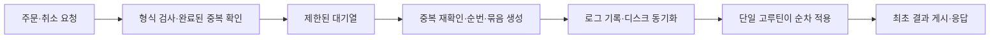
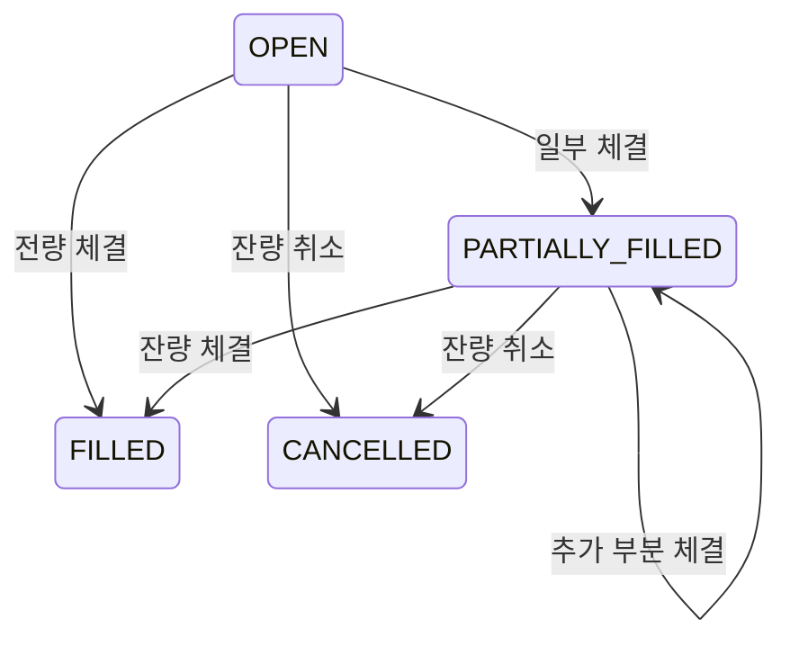

# exchange v1: 주문 처리와 복구 설계

상태: Accepted
합의 반영일: 2026-10-29 (Asia/Seoul)
구현·실측 상태: 미착수

## 문제와 목표

[제품 명세](../product-specs/exchange.md)의 EX-R01~EX-R13을 구현할 설계다. 단일 거래쌍의 주문 접수부터 영구 저장·상태 적용·응답까지 측정하며, 응답한 결과를 재시작 후 재현한다. 기존 코드나 데이터는 아직 없으며 최초 구현을 대상으로 한다.

사용자가 상세 설계의 문서 반영을 요청한 내용을 기준으로 한다. 모듈 경로·Go 버전·구체적인 wire API·가격 단위·성능 기준값은 [구현 계획](../exec-plans/active/20261029-1531-exchange-v1.md)의 결정 단계에서 확정할 항목이다. Accepted는 설계 합의이며 실행·내구성 검증 완료가 아니다.

## 1. 처리 경로와 소유권



1. API는 계정 식별과 필수 필드·정수 단위·크기·범위·지원 버전을 검사하고 내용을 정규화한다. 계정은 서버가 검증한 테스트 계정 문맥에서 얻는다. 본문의 임의 계정 ID를 신뢰하는 방식은 기본안이 아니다.
2. 완료된 동일 요청은 안전하게 게시한 불변 결과에서 반환할 수 있다. 캐시가 없다면 제한된 대기열에 넣는다. 실패하면 이번 시도를 즉시 과부하 거절한다.
3. 처리 고루틴은 중복을 다시 확인하고 처음 보는 명령에 연속 `commandSeq`를 부여한다. 배치는 최대 개수·최대 바이트·첫 명령 기준 최대 대기 시간 중 먼저 충족한 조건으로 닫는다.
4. WAL 고루틴은 순서가 고정된 배치를 쓰고 내구성 동기화를 수행한다. 동기화 성공 전에는 해당 명령으로 업무 상태를 바꾸거나 최종 주문 결과를 응답하지 않는다.
5. 처리 고루틴은 저장된 명령을 순서대로 적용한다. 잔고와 현재 주문 상태의 검사는 이 시점에 한다. 적용 결과에는 승인과 업무 거절 모두 포함한다.
6. 명령 하나의 모든 상태 변경과 최초 결과 기록을 끝낸 뒤 불변 응답을 게시한다. 응답 I/O는 처리 고루틴을 막지 않도록 분리한다. 느린 클라이언트의 응답 대기 공간도 제한한다.

v1은 한 배치를 저장·적용한 뒤 다음 배치를 처리한다. 요청 수신은 병행한다. 배치 저장과 다음 배치 적용을 겹치는 최적화는 기준 구현 이후 검증할 변경이다.

호가창·잔고·주문·중복 결과의 논리 상태는 단일 처리 고루틴만 변경한다. WAL 고루틴은 바이트를 기록하며 거래 승인 여부를 판단하지 않는다. API는 업무 맵을 직접 읽거나 수정하지 않는다. 현재 상태 조회는 명령 적용 경계에서 만든 사본으로 반환하고 `asOfSeq`를 포함한다. 완료 결과의 빠른 조회를 추가한다면 안전한 동시 읽기 구조에 불변 값을 게시하며, 캐시의 존재만으로 미완료 요청을 완료로 판단하지 않는다.

| 순번 | 의미 |
| --- | --- |
| durableSeq | 영구 저장을 확인한 마지막 연속 명령 |
| appliedSeq | 상태와 최초 결과를 완전히 반영한 마지막 명령 |
| snapshotSeq | 게시된 스냅샷에 포함된 마지막 명령 |

항상 `snapshotSeq ≤ appliedSeq ≤ durableSeq`를 유지한다. 그룹 저장 완료는 그 안의 주문 전체가 승인됐다는 뜻이 아니다. 같은 배치 안에서도 앞 주문의 결과에 따라 뒤 주문이 잔고 부족으로 거절될 수 있다.

연결 종료나 요청 timeout은 이미 접수한 명령을 취소하지 않는다. 취소는 독립적인 명령이다. 접수 전 요청 거절과 접수 후 결과 미확정을 구분한다.

## 2. 명령과 자료형

| 명령 | 주요 입력 | 상태 변경 |
| --- | --- | --- |
| Genesis | runId, 계정·초기 잔고, 거래쌍·단위·한도, 규칙 버전 | 새 실험의 최초 상태 생성 |
| PlaceOrder | 계정, clientOrderId, 거래쌍, side, 지정가, 수량 | 예약·매칭·호가 등록·최초 결과 |
| CancelOrder | 계정, cancelRequestId, 대상 clientOrderId | 활성 잔량 취소·예약 해제·최초 결과 |

Genesis는 별도 초기화 절차이며 실행 중 입금 API가 아니다. 일반 서버 시작은 기존 데이터를 복구한다. 기존 디렉터리에 Genesis를 덮어쓰거나 재지급하지 않는다. 새 실험에는 새 디렉터리와 runId를 사용한다.

가격·수량·잔고·대금은 정수로 표현한다. 수량 `q`는 최소 base lot 개수, 가격 `p`는 base lot 하나의 가격을 quote 최소 단위로 표시한 정수로 정의하여 `대금 = p × q`가 정확하게 성립하도록 한다. 해당 격자에 맞지 않는 입력은 반올림하지 않고 거절한다. 외부 표현과 정수 크기·최대값은 P0에서 고정한다.

정규화는 금액을 float로 거치지 않고 수행한다. 곱셈·합계의 overflow와 음수·0·최대값을 검사한다. 초기 자산 총량과 주문 한도를 포함해 모든 예약·체결 경로에서 정수 범위를 넘지 않도록 검증한다. 중간 변경 후 overflow를 발견해 부분 결과를 계속 노출하는 방식은 허용하지 않는다.

## 3. 주문 상태 전이

요청의 큐 대기·로그 기록 상태와 주문의 업무 상태는 별개다. 처리 전 요청을 OPEN 주문으로 노출하지 않는다.

| 주문 상태 | 조건 | 예약 잔고 |
| --- | --- | --- |
| OPEN | executedQty=0, openQty>0 | 잔량분 유지 |
| PARTIALLY_FILLED | executedQty>0, openQty>0 | 잔량분 유지 |
| FILLED | 전량 체결 | 0 |
| CANCELLED | 미체결 잔량 취소, 체결분은 유지 | 0 |
| REJECTED | 상태 검사에서 승인되지 않음 | 0 |

신규 주문은 한 명령의 처리 결과에 따라 위 어느 상태로도 바로 끝날 수 있다. 들어오자마자 전량 체결되면 FILLED, 자기 거래 차단으로 잔량이 취소되면 CANCELLED다. OPEN/PARTIALLY_FILLED만 호가창에 존재한다.



승인된 주문에는 `originalQty = executedQty + openQty + cancelledQty`가 성립한다. REJECTED에는 예약·호가 등록이 없으며 이 승인 주문의 수량 보존식과 구분한다. 종료 상태는 다시 열지 않고 새 주문 ID로 새 주문을 만든다.

| 취소 대상의 현재 상태 | 취소 명령 결과 | 원래 주문 변경 |
| --- | --- | --- |
| OPEN/PARTIALLY_FILLED | CANCELLED | 호가 제거, 잔량을 cancelledQty로 이동, 예약 해제 |
| FILLED | ALREADY_FILLED | 없음 |
| CANCELLED | ALREADY_CANCELLED | 없음, 두 번 해제하지 않음 |
| 없음/다른 계정/REJECTED로 승인 주문이 아님 | ORDER_NOT_FOUND | 없음 |

취소 결과는 주문 상태와 별도다. 같은 취소 요청 ID의 재시도는 최초 결과를 반환한다. 취소와 체결의 우선순위는 처리 순번으로 결정하며 뒤의 취소가 앞선 체결을 되돌리지 않는다.

## 4. 매칭과 자기 거래 차단

1. 새 주문의 최대 필요 금액·수량을 검사하고 전부 예약한다.
2. 매수는 최저 매도부터, 매도는 최고 매수부터 확인한다. 지정가가 교차하지 않으면 종료한다.
3. 같은 가격의 우선순위는 원래 PlaceOrder의 commandSeq다. 시각·재시도·조회는 순위를 변경하지 않는다.
4. 다음 체결 상대가 같은 계정이면 새 주문의 잔량을 취소하고 종료한다. 상대를 건너뛰어 뒤 주문과 계속 체결하지 않는다.
5. 다른 계정이면 대기 주문 가격으로 양쪽 잔량 중 작은 수량을 체결한다.
6. 잔량이 남으면 반복한다. 체결 가능한 상대가 없으면 잔량을 호가창에 등록한다.

자기 거래 차단 이유는 SELF_TRADE_PREVENTION으로 남긴다. 기존 대기 주문의 상태·예약은 변경하지 않는다. 새 주문이 다른 계정과 이미 체결한 부분은 유지한다.

첫 호가 자료구조는 가격 정렬과 가격별 FIFO, 주문 ID 조회를 제공하는 명확한 구현을 선택한다. 구체적인 트리/힙/배열 선택은 P1에서 기록하고, 자료구조 최적화는 동일 입력 결과를 보존하는 성능 실험으로 다룬다.

## 5. 잔고 예약·체결·해제

계정마다 자산별 `available`, `reserved`를 두며 합계가 해당 계정의 총잔고다. 아래 `L`은 매수 지정가, `P`는 체결 가격, `Q`는 주문 수량, `x`는 이번 체결 수량이다.

| 시점 | 변화 |
| --- | --- |
| 매수 예약 | quote.available -= L×Q, quote.reserved += L×Q |
| 매도 예약 | base.available -= Q, base.reserved += Q |
| 매수자 체결 | quote.reserved -= L×x, quote.available += (L−P)×x, base.available += x |
| 매도자 체결 | base.reserved -= x, quote.available += P×x |
| 매수 잔량 취소 | quote.reserved에서 L×openQty를 available로 이동 |
| 매도 잔량 취소 | base.reserved에서 openQty를 available로 이동 |

최대 필요 잔고가 부족하면 주문 전체를 REJECTED로 끝낸다. 현재 호가가 유리하다는 이유로 최대 예약분을 줄이지 않는다. 취소와 자기 거래 차단에는 현재 남아 있는 예약분만 해제한다.

예: 초기 화폐 2,000, 매수 105×10, 100에 4개 체결 후 잔량 취소.

| 단계 | quote.available | quote.reserved | 취득 base |
| --- | ---: | ---: | ---: |
| 시작 | 2,000 | 0 | 0 |
| 예약 | 950 | 1,050 | 0 |
| 4개 체결 | 970 | 630 | 4 |
| 잔량 취소 | 1,600 | 0 | 4 |

최종 지출은 400이다. 가격 차액 20과 잔량 예약금 630이 각각 반환된다.

불변식:

- available과 reserved는 음수가 아니다.
- 계정의 reserved는 해당 계정 활성 주문의 예약분 합계다.
- 종료된 주문은 예약분이 0이며 호가창에 존재하지 않는다.
- 승인 주문의 수량 보존식이 성립한다.
- 자산별 모든 계정의 available+reserved 합계는 Genesis의 공급량과 같다.
- 동일 체결은 양쪽 수량·대금을 함께 반영한다.

한 명령이 여러 상대 주문과 체결되더라도 전체 적용 중 조회·스냅샷·응답에 중간 상태를 노출하지 않는다. 불변식 위반이나 내부 오류가 발생하면 거래 처리를 중단하고 복구 절차로 전환한다. 부분 상태를 유지한 채 다음 주문을 받지 않는다.

## 6. WAL·그룹 커밋·결정적 재생

로그는 결과를 재현할 수 있는 정규화된 명령을 기록한다. 첫 버전에서 승인·거절 결과의 영속성은 결정적인 명령 재생과 스냅샷의 최초 결과 기록으로 확보한다.

각 기록에는 형식·규칙 버전, runId, commandSeq, 정규화된 본문, 최초 응답에 필요한 시각 등 고정 입력, 길이·체크섬이 포함된다. 바이트 인코딩·최대 프레임 크기·체크섬 범위는 P0/P2에서 버전과 함께 고정한다.

```text
그룹 헤더: 버전, 시작/끝 순번, 명령 수, 길이
명령 N
명령 N+1
...
그룹 완료 표식과 체크섬
영구 저장 동기화
→ durableSeq 전진
→ 명령 순서대로 상태 적용
```

배치의 바이트 쓰기와 영구 동기화 완료를 구분한다. short write를 처리하고, 파일 생성·세그먼트 전환의 파일 시스템 메타데이터도 필요한 동기화 절차에 포함한다. 동기화 실패 시 해당 배치를 적용하지 않으며 이후 명령의 처리를 중단한다.

그룹 완료 표식은 프레임의 완전성을 판정하는 정보이며 과거 동기화 성공 자체를 증명하지는 않는다. 프로세스 재시작 후 완전히 남은 유효한 미응답 그룹도 재생할 수 있다. 읽어낸 로그가 OS 캐시에만 남아 있을 가능성까지 고려해, 복구한 유효 로그와 필요한 메타데이터의 내구성을 확정한 후 준비 완료·중복 결과 응답을 허용한다.

엔진은 재생 중 벽시계·새 난수·외부 API·비결정적 map 순회에 의존하지 않는다. FIFO는 commandSeq, 체결 ID는 `runId + commandSeq + 체결 번호` 등 결정적 값으로 만든다. 과거 응답에 노출할 시각은 입력 기록에 고정한다. 같은 명령과 이전 상태에서 같은 상태·결과를 생성해야 한다.

규칙 버전을 기록하는 것만으로 구버전 재생이 보장되지는 않는다. 해당 버전의 동일한 실행 의미를 지원하거나 기동을 거절한다. 의미가 달라지는 업데이트는 명시적인 호환성·migration 작업으로 취급한다.

## 7. 스냅샷과 복구

Genesis의 초기 잔고를 포함해, WAL과 검증된 스냅샷이 복구 기준이다. 데이터 디렉터리는 단일 프로세스만 소유하도록 잠근다.

스냅샷에는 다음을 포함한다.

- runId, 설정·규칙·응답 형식 버전과 설정 식별값.
- snapshotSeq와 주문 우선순위를 보존하는 상태.
- 계정별 잔고, 활성·종료 주문, 조회에 필요한 체결 기록.
- 중복 키, 정규화된 원래 내용, 최초 업무 결과.
- 길이·체크섬 등 완전성 검사 정보.

생성은 명령 적용 완료 경계 S에서 일관된 사본을 만든 뒤 시작한다. 별도 저장 고루틴이 사본을 임시 파일에 쓰고 동기화한 다음 정식 파일로 게시하고 필요한 디렉터리 메타데이터를 동기화한다. 새 스냅샷이 안전하게 게시되기 전에는 기존 것을 제거하지 않는다. v1은 실험 중 WAL을 삭제하지 않는다.

처음에는 사본을 만드는 동안 처리 고루틴을 잠시 멈추는 방식을 쓴다. 변경 중인 map을 비동기로 그대로 읽지 않는다. 복사 시간·추가 메모리·GC·p99 영향을 성능 보고서에 포함한다.

복구 순서:

1. 디렉터리 소유권, runId, Genesis와 버전·설정을 확인한다.
2. 사용 가능한 스냅샷 중 검증된 최신 상태를 읽는다. 없으면 Genesis에서 시작한다.
3. snapshotSeq 이후 유효한 연속 로그를 commandSeq 순서로 적용한다.
4. 초기 상태부터 복구한 주문·잔고·중복 결과의 불변식을 확인한다.
5. 남길 로그와 복구 과정의 절단·메타데이터 변경을 내구성 절차로 확정한다.
6. 다음 순번을 복구한 마지막 명령 다음으로 잡고 준비 완료 후 요청을 받는다.

| 로그·스냅샷 상태 | 정책 |
| --- | --- |
| 정상 그룹 뒤 물리 EOF에서 잘린 마지막 미완성 그룹 | 마지막 정상 그룹 경계까지만 보존하고 미완성 꼬리를 정리 |
| 완전한 프레임의 체크섬 오류 | 자동 폐기하지 않고 기동 중단 |
| 중간 손상·순번 누락·중복/역전·버전 불일치 | 기동 중단 |
| 최신 스냅샷 손상 | 이후 로그가 모두 있을 때만 이전 정상 스냅샷 또는 Genesis에서 복구 |
| 로그·스냅샷의 runId/설정 불일치 | 기동 중단, 자동 초기화 금지 |

불확실한 손상을 마지막 미완성 꼬리로 임의 분류하지 않는다. 로그 정리·스냅샷 교체 실패로 성공 응답한 명령을 유실시키지 않는 것을 검증한다.

## 8. 중복·재시도·결과 조회

신규 주문 키는 `(runId, accountId, PlaceOrder, clientOrderId)`, 취소 키는 `(runId, accountId, CancelOrder, cancelRequestId)`다. 각 최초 키의 정규화된 입력과 최초 결과를 실험 동안 보존한다.

| 상태 | 동작 |
| --- | --- |
| 같은 키·내용, 완료 | 최초 결과를 불변 값으로 반환 |
| 같은 키·내용, 진행 중 | 기존 처리에 대기자를 연결, 새 순번·로그·주문을 만들지 않음 |
| 같은 키·다른 내용 | IDEMPOTENCY_CONFLICT, 최초 결과를 덮어쓰지 않음 |
| 처음 보는 키 | 새 명령 경로로 처리 |

API에서 완료 캐시를 봤더라도 처리 고루틴에서 재확인하여 동시에 들어온 요청을 합친다. 진행 중 키의 임시 기록은 업무 상태와 구분하며 대기자 수를 제한한다. 클라이언트가 전부 연결을 끊어도 이미 접수한 명령의 처리는 계속한다. 재시작 후에는 로그·스냅샷에서 완료 결과를 재구성한다.

숫자·필드 표현의 차이는 정규화하되 계정·거래쌍·side·가격·수량·대상 주문 등 의미 있는 입력은 전부 비교한다. 해시는 조회 보조이며 원문 의미의 동등성은 정규화된 값으로 확인한다.

최초 생성 응답이 OPEN이고 현재 주문이 FILLED여도 생성 재시도는 최초 OPEN 결과를 반환한다. 현재 상태는 별도 조회와 asOfSeq로 확인한다. 최초 업무 거절도 그대로 유지하며 잔고가 변했다고 다시 실행하지 않는다.

형식 오류·계정 식별 실패·이번 시도의 과부하 거절처럼 명령 접수 이전의 실패는 최초 업무 결과를 생성하지 않는다. 이미 접수한 뒤 결과가 불확실한 경우는 확정적인 REJECTED로 응답하지 않는다.

실험 중 결과·종료 주문·ID를 임의 만료/재사용하지 않는다. 이로 인한 메모리·로그 증가량을 측정하고 실험 크기를 제한한다. 보존 기간 변경이나 압축은 별도 설계 없이 최적화로 도입하지 않는다.

## 9. 장애·응답 경계

| Flow/장애 | 응답 의미 | 내부 상태·재시도 |
| --- | --- | --- |
| 형식 오류·큐 포화 | 이번 요청 미접수 | 같은 ID의 과거 시도가 미처리라는 뜻은 아님 |
| 접수 후 연결 종료·timeout | 결과 미확정 | 자동 취소하지 않고 같은 ID 재시도 |
| 로그 쓰기·동기화 실패 | 결과 미확정, 준비 상태 해제 | 이후 처리 중단, 복구 시 실제 남은 유효 기록 확인 |
| 저장 완료·적용 전 종료 | 응답이 없을 수 있음 | 재생하여 적용 |
| 명령의 여러 체결 중 종료 | 일부 메모리 상태는 외부 게시 안 됨 | 정상 스냅샷부터 명령 전체 재생 |
| 적용 완료·응답 유실 | 클라이언트에는 미확정 | 최초 결과 반환 |
| 성공 응답 후 종료 | 처리 결과 확정 | 상태와 중복 결과 복구 |
| 내부 불변식 위반 | 서비스 정상 결과로 위장하지 않음 | 거래 중단, 원인과 로그 보존 |

정상 종료는 신규 접수를 멈추고 접수한 명령의 저장·적용을 마친 뒤 종료한다. 강제 종료에서는 기록된 상태로 복구한다. 재생 자체가 실패하면 요청을 받지 않는다.

전원 장애 목표에는 OS·파일 시스템·저장장치가 동기화 계약을 지킨다는 전제가 있다. 파일 write만으로 내구성을 주장하지 않는다. 대상 Go/OS에서 파일·드라이브 캐시·메타데이터 동기화 경로를 확인한다. macOS의 일반 fsync와 F_FULLFSYNC 차이를 검토하고 필요한 강한 동기화를 지원하지 못하면 보장 수준을 조용히 낮추지 않는다. 프로세스 강제 종료, 저장 오류 주입, OS·전원 장애 검증은 서로 다른 증거로 기록한다.

## 10. 대안과 선택 이유

| 대안 | 채택한 방향과 이유 |
| --- | --- |
| 여러 고루틴이 같은 호가창·잔고 변경 | 단일 소유자로 순서·재생을 단순화하고 잠금 경합 영향을 줄여 측정 |
| 주문마다 영구 동기화 | 그룹 커밋으로 동기화 비용과 대기 시간의 절충을 실험 |
| DB 트랜잭션 중심 저장 | 명령 로그·스냅샷으로 저장·복구 경로를 직접 학습 |
| 저장 전 상태 적용·빠른 성공 응답 | 영구 저장 후 적용·응답하여 확정 결과의 복구 경계를 명확히 함 |
| 처음부터 다중 배치 파이프라인 | 한 배치 저장·적용 기준 구현을 먼저 검증한 뒤 비교 |
| 현재 주문 상태를 중복 응답으로 반환 | 최초 명령 결과와 현재 상태 조회를 분리 |

## 11. 검증 시나리오와 영향

[구현 계획](../exec-plans/active/20261029-1531-exchange-v1.md)의 단계별 완료 조건에 연결한다. 다음은 아직 실행하지 않은 요구 검증이다.

| ID | 시나리오 | 관찰할 결과 |
| --- | --- | --- |
| V01 | 가격·FIFO·대기 주문 가격·다중 가격 체결 | 기대 주문 순서와 가격·수량 일치 |
| V02 | 가격 개선·부분 체결·취소 | 예제 계산과 예약분·공급량 보존 |
| V03 | 일부 다른 계정 체결 후 자기 주문 만남 | 기존 체결 유지, 새 잔량 취소, 기존 자기 주문 유지 |
| V04 | 같은 계정 잔고를 소진하는 동시 주문 | 순서에 따라 승인/거절, 초과 지출 없음 |
| V05 | 동일 키 동시 재시도·다른 내용·거절 재시도 | 한 번만 실행, 최초 결과 유지 또는 충돌 |
| V06 | 취소·체결 경합과 취소 재시도 | 순번에 맞는 결과, 중복 해제 없음 |
| V07 | 매 write/sync/apply/response 경계에서 오류·종료 | 정상 실행과 복구 상태·최초 결과 일치 |
| V08 | 그룹 마지막 바이트 절단·checksum 오류·중간 누락 | 허용된 꼬리만 정리, 불확실한 손상은 기동 중단 |
| V09 | 스냅샷 복사·게시 도중 종료·오래된 스냅샷 복구 | 하나의 완전한 상태 경계에서 재개 |
| V10 | 무작위 명령·재생·조회·응답 경쟁 | 불변식·독립 기준 모델 일치, data race 없음 |
| V11 | 큐 포화·느린 클라이언트·재시도 폭주 | 즉시 과부하 응답, 처리·대기자·메모리 경계 유지 |
| V12 | 같은 데이터로 일반 재시작 반복 | 초기 잔고 재지급 없음, runId·순번·ID 보존 |

변경할 기존 애플리케이션·DB migration·외부 서비스는 없다. 앞으로 생성할 데이터 형식은 버전을 가지며 과거 기록 호환성을 검증해야 한다. API 전송 방식·계정 식별·권한 오류 형식은 P0에서 계약을 확정하고 실제 구현으로 확인한다.

## 12. 남은 결정과 검증 한계

| 항목 | 정할 시점 |
| --- | --- |
| Go 버전·모듈 경로·Go 검증 환경 | P0/P1 |
| 가격·수량·총공급량 한도, API 전송·필드·오류·계정 식별 | P0 |
| WAL·스냅샷 인코딩·호환성·플랫폼 동기화 방법 | P0/P2 |
| 자료구조·배치·대기열·스냅샷 주기 | P1 이후 기준 구현, P7 측정으로 조정 |
| p99 상한·부하 비율·기간·거절률·실험 크기 | P6 초기 측정 후 P7 비교 전에 고정 |
| 실제 OS·전원 장애 증거 | P5의 별도 검증 범위에서 확보, 미확보 시 명시 |

단순 계산·모델 테스트 통과는 실제 파일 시스템의 전원 장애 보장을 증명하지 않는다. 코드와 환경 검증이 없는 현재는 성능 수치와 내구성 달성을 주장하지 않는다.

## 참고 자료

- [Go 진단 도구](https://go.dev/doc/diagnostics): CPU·메모리·잠금 경합 분석.
- [Go File.Sync](https://pkg.go.dev/os#File.Sync): 파일 동기화 API 계약. 대상 버전의 실제 플랫폼 구현은 구현 단계에서 확인한다.
- [WAL과 그룹 기록 원리](https://www.postgresql.org/docs/current/wal-intro.html): 영구 기록과 상태 반영의 순서, 여러 명령의 동기화 비용 공유.
- [저장장치 신뢰성](https://www.postgresql.org/docs/current/wal-reliability.html): 캐시·부분 쓰기·장치 동기화의 전제.
- [Apple fsync 설명](https://developer.apple.com/library/archive/documentation/System/Conceptual/ManPages_iPhoneOS/man2/fsync.2.html): 일반 fsync와 F_FULLFSYNC의 차이. 보관 문서이며 대상 OS에서 재확인한다.
