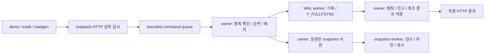

# exchange 프로젝트 결과 보고서

기준일: 2026-11-12 (Asia/Seoul). 구현 기준: master [`3a23e1b`](https://github.com/gaon000/exchange/commit/3a23e1b69853645d336e9a11702f7c42f006e38a). 이 문서는 해당 코드와 보관된 검증·실험을 종합한다. 이번 문서 작업에서 새 성능 측정은 수행하지 않았다.

단일 거래쌍 모의 현물 거래소의 주문·취소·조회, 정수 잔고 예약/정산, 영구 로그와 스냅샷 복구를 구현했다. 실제 HTTP 거래와 프로세스 종료 후 상태·최초 결과 복구를 검증했고, 거래·복구 데모와 수동 거래 CLI, 부하/진단/자료 보관 도구를 제공한다. **실제 OS·전원 장애 검증은 미완료·보류다.** 이를 필수로 포함하는 v1 전체 계획은 Blocked로 유지한다.

최신 보관 처리량 캠페인인 2026-11-09의 같은 producer 누적 24회에서는 **snapshot을 끈 정상 조건 2,000 requests/s만 qualified=true**다. 이는 특정 빌드·장비·호스트 상태·짧은 측정 조건의 관찰 채택점이며 현재 master의 최대 처리량이나 서비스 SLA가 아니다. 고정 상태에서는 복구/생성 비용을 줄였지만 동시 주문의 지연·최대 지속 처리량 개선은 확정하지 않았다.

## 1. 범위와 결과물

개발자가 주문 처리·저장·복구를 학습하고, 성능 판단의 근거와 한계를 제시하기 위한 프로젝트다. [제품 명세](product-specs/exchange.md)가 제품 범위·정책을 소유한다.

| 결과물 | 현재 제공하는 내용 | 진입점 |
| --- | --- | --- |
| 거래 서버 | init/serve, 로컬 HTTP 주문·취소·잔고/호가/체결/주문/결과 조회 | [CLI와 개발 기준](development.md), [API 계약](design-docs/api-v1.md) |
| 거래·복구 데모 | 부분 체결·취소·자기 거래 차단·예약금 반환·중복 ID 충돌·WAL/snapshot/SIGKILL 복구 | [한 명령 데모](trading-demo.md) |
| 수동 거래 CLI | 계정/가격/수량 지정, 현재 상태와 최초 결과 조회, 저장한 요청으로 같은 ID 재시도 | [거래용 CLI](trading-cli.md) |
| 측정·진단 | open-loop HTTP 부하, 계측/원본 재집계·반복 판정, trace/OS I/O·타이머 분석, JSON/Markdown 비교 | [측정 계약](design-docs/benchmark-v1.md), [진단 도구](diagnostic-tools.md), [자동 비교](experiment-comparison.md) |
| 자료 보관 미리보기 | var 용량·경로/해시 참조·원본/고정 빌드 보호와 삭제 후보 표시 | [보관·정리 안내](artifact-retention.md). 실제 삭제 기능은 제공하지 않음 |

지원 저장 환경은 Go 1.27.3·macOS arm64·로컬 APFS·cgo이며, 측정 장비는 Apple M3 Pro 11 CPU/18GiB·macOS 15.8이었다. Linux portable CI는 일반 로직과 저장 미지원 시 안전한 실패를 검증한다. Linux에서 거래 저장소의 운영을 지원한다는 의미는 아니다.

실제 자산·실입출금·실행 중 모의 입출금·수수료·시장가·다중 거래쌍·웹 거래 화면·고가용성 복제·운영 배포는 v1 범위 밖이다. 초기 계정/자금은 새 실험에서만 설정하며 재시작으로 잔고를 다시 지급하지 않는다.

## 2. 구현 구조와 요청 흐름

호가·주문·잔고·체결·최초 결과는 **한 owner 고루틴**이 순차 변경한다. HTTP 수신, WAL 저장, 불변 snapshot 사본의 저장은 별도 고루틴으로 수행한다. 서버 전체를 한 OS 스레드에서 실행하는 구조는 아니다. [Architecture](../ARCHITECTURE.md)에 전체 모듈과 의존 방향을 기록한다.



도식의 owner 노드는 같은 고루틴이다. 최초 변경의 기본 순서는 `형식/문맥 검사 → 제한된 큐 → 중복/순번 → WAL 그룹 기록과 엄격한 동기화 → 순차 Apply → 최종 응답`이다. 완료 중복은 최초 결과를 반환하고 pending 중복은 기존 처리에 연결하여 새 명령을 기록하지 않는다. 조회는 별도 제한된 query queue를 거쳐 명령 전체 적용 경계의 사본을 반환한다. 서로 다른 조회의 동일 시점은 보장하지 않는다.

| 계층 | 주요 책임과 경계 |
| --- | --- |
| [domain](../internal/domain/types.go), [engine](../internal/engine/engine.go) | 정수/입력/결과 타입, 가격/FIFO 매칭과 잔고·주문 상태 변경. 엔진은 파일/HTTP에 의존하지 않음 |
| [runtime](../internal/runtime/owner.go) | 한 상태 소유자, bounded queue/배치, 중복 결과·순번·조회·종료 합류 |
| [durable](../internal/durable/darwin.go), [WAL](../internal/wal/store.go), [snapshot](../internal/snapshot/codec.go) | 플랫폼 저장 경계, 초기 설정/순차 로그, canonical snapshot과 게시 |
| [API](../internal/api/server.go), [exchange](../cmd/exchange/main.go) | 엄격한 로컬 전송/계정·run 문맥, 프로세스 수명과 모듈 조립 |
| [bench](../internal/bench/plan.go), [telemetry](../internal/telemetry/histogram.go) | 공개 HTTP의 예정/실제 전송·결과 집계와 bounded 지연/자원 관찰. 엔진을 직접 호출해 전체 경로를 우회하지 않음 |

## 3. 거래 규칙

아래는 구현한 정책의 요약이다. 정의와 예외는 [제품 정책](product-specs/exchange.md#제품-정책과-예외), [상세 설계](design-docs/exchange-v1.md), [정수·입력 계약](design-docs/api-v1.md)을 따른다.

| 항목 | 적용 규칙 |
| --- | --- |
| 주문 | BTC-USDT 지정가 GTC, 부분 체결·미체결 잔량 취소 |
| 우선순위·가격 | 가격 우선, 같은 가격에서는 서버 순번 FIFO. 체결가는 먼저 기다리던 주문의 가격 |
| 자기 거래 | 같은 계정의 상대 주문을 만나면 신규 주문의 남은 수량 취소. 기존 상대 주문과 이미 다른 계정과 체결한 부분은 유지 |
| 예약·정산 | 매수의 최대 대금/매도 수량 전부를 예약. 부족하면 전체 거절. 체결 대금/수량을 정산하고 가격 개선 차액·취소 잔량의 예약금을 반환 |
| 단위 | int64 기반 비음수 정수. 1 lot=0.0001 BTC, 1 atom=0.000001 USDT, 표시 가격=priceTicks/100 USDT/BTC. wire 정수는 문자열 |
| 중복 | `(runId, accountId, 명령 종류, 요청 ID)`로 구분. 같은 내용은 최초 결과, 다른 내용은 409 충돌. 취소는 별도 취소 요청 ID |
| 최초 결과와 현재 상태 | 최초 OPEN 응답은 이후 체결/취소 뒤에도 변하지 않음. 현재 주문 상태는 별도 조회 |
| 거절·응답 유실 | 잔고 부족 등 저장된 업무 거절도 HTTP 200의 최종 결과. queue 포화의 NOT_ADMITTED는 이번 시도만 뜻함. timeout/연결 종료는 자동 취소가 아니며 같은 ID로 조회/재시도 |
| 자금·한도 | 수수료/실행 중 입출금 없음, 자산별 공급량 보존. 초기 자금은 init에서만 설정. 명령 한도는 실험 설정에 고정하며 중복 기록은 해당 실험에서 만료시키지 않음 |

## 4. 저장·복구 계약과 검증된 범위

### 계약

성공한 변경뿐 아니라 저장된 업무 거절의 최초 결과도 복구 대상이다. 정상 저장장치와 지원 환경의 동기화 계약을 전제로 한다. [저장 형식](design-docs/storage-v1.md)과 [복구 코드](../internal/runtime/recovery.go)가 세부 검증과 실패 정책을 소유한다.

- `genesis.bin`은 초기 설정/자금·runId, WAL은 정규화된 순차 명령이다. 데이터 디렉터리 잠금으로 프로세스 하나만 소유한다.
- WAL의 완전한 그룹을 기록하고 `F_FULLFSYNC`가 성공한 뒤 상태에 적용·응답한다. 저장 실패를 더 약한 동기화나 메모리 승인으로 대체하지 않는다.
- snapshot은 명령 경계의 분리된 사본을 검사·직렬화하고 file sync → exclusive rename → directory sync로 게시한다. owner 사본 생성에는 정렬 비용도 남아 있다.
- 기동 시 snapshot의 형식/identity/의미를 검사하고, snapshot에 담긴 명령·순번을 전체 WAL의 prefix와 대조한다. 이후 WAL tail을 Apply한다. 과거 prefix를 새 매칭으로 전부 다시 실행하는 방식과 구분한다.
- 최신 후보를 사용할 수 없으면 이전 정상 snapshot 또는 Genesis+WAL 복구를 시도한다. WAL 자체의 완전한 그룹 손상을 정상 tail 절단으로 숨기지 않는다. 마지막 불완전 EOF tail만 규칙에 따라 처리한다.
- 잘린 tail 처리·필요한 재동기화와 최종 불변식 검증을 확정한 뒤 readiness를 연다. 이미 저장됐을 수 있는 미응답 명령은 복구될 수 있으므로 새 ID로 대체하지 않는다.

### 검증 상태

| 항목 | 상태·근거 | 해석 범위 |
| --- | --- | --- |
| 매칭·잔고·중복 | 독립 기대값/모델·경계/fuzz·동시 HTTP 검증 | 정수·가격/FIFO·예약/공급량과 최초 결과 계약 |
| 저장 오류·손상·게시 | WAL 오류 주입/절단, snapshot golden/잘못된 후보/fallback·실제 APFS sync/잠금 | 계층 오류와 통합 검증의 경계를 구분 |
| 프로세스 종료·응답 유실 | [HTTP 12개 경계](../internal/runtime/http_process_native_test.go), [게시 경계](../internal/snapshot/publish_darwin_test.go) 및 재시작 검증 | 소유 자식 프로세스 장애. OS/장치 캐시는 살아 있음 |
| 한 명령 데모 | [확장 데모](exec-plans/completed/20261112-expanded-trading-demo.md)의 WAL6, snapshot6+WAL0, SIGKILL 뒤 snapshot6+WAL1 복구 | POST 재시도 전에 상태·최초 결과 GET 검증, 예약금 유지/반환 |
| 수동 CLI 재시도 | [실제 서버 재시작](../cmd/trade/native_test.go)과 timeout/잘린 응답·같은 ID/본문 재전송 | 요청 파일 보존과 서버 중복 검사. 요청 파일을 WAL 내구성 증거로 사용하지 않음 |
| 실제 OS·전원 장애 | **미완료·보류**. 별도 장비 없음, [절차](power-loss-validation.md)만 준비 | 프로세스 SIGKILL·APFS 호출·CI 성공으로 대체하지 않음 |

snapshot은 전체 WAL·최초 결과 이력을 없애는 보존 정책이 아니다. 현재는 전체 WAL 검사와 중복 결과/주문/체결 이력이 남으며, 상태가 커질수록 메모리·복사·검증/복구 비용이 증가한다. 디스크 자체의 유실/손상 복구, 외부 복제·백업으로부터의 복원, 무제한 장기 운전은 검증 범위가 아니다.

## 5. 성능 결과와 해석

### 판정 기준

[criteria-v1](../config/benchmarks/criteria-v1.json)과 [P6 조건](benchmarks/p6-baseline.md#고정-비교-조건-v1)은 전체 요청 p99 및 고유 신규 주문의 예정 시각 기준 p99 각각 20ms 이하, 5초 창별 요청/예정 지연 p99 20ms 이하, 생성기 미전송·운영 오류 0, 최소 독립 3회와 모든 포함 실행의 통과를 요구한다. 워밍업 5초/본 측정 20초, seed 17, rest/marketable/cancel/duplicate/rejectProbe=35/30/10/15/10을 사용했다. snapshot 조건의 주기는 5초이며 측정 교집합 완료 이벤트도 확인한다.

여기서 marketable은 즉시 체결 가능한 가격의 지정가 요청이며 시장가 주문을 의미하지 않는다.

각 5초 창에는 계측 관찰이 최소 8개 있어야 한다. 마지막 창의 command queue 평균이 첫 창보다 64개 넘게 증가하면 탈락시켜, 빠른 일부 구간만으로 시간에 따라 대기열이 커지는 실행을 채택하지 않는다.

`requests/s`는 예정 시도율이다. 중복·업무 거절·취소를 신규 승인 주문 처리량에 합산하지 않는다. 예를 들어 최신 2,000/s 신규 3회의 고유 신규 승인 주문은 약 1,298.05~1,298.10/s였다. p99는 분위수이며 모든 요청의 최대 지연 보장이 아니다. 20초 결과를 무제한 지속 성능으로 확대하지 않는다.

### 시점·빌드별 처리량 근거

| 시점·근거 | 조건/결과 | 현재 해석 |
| --- | --- | --- |
| 2026-10-29 [P6 기준](benchmarks/p6-baseline.md), [P7 snapshot 한계](benchmarks/p7-snapshot-capacity.md) | 당시 정상 29,000/s 3회 채택, snapshot 3,000/s 3회 채택·4,000/s 실패 | 당시 빌드/환경의 결과. 아래 재측정 실패와 함께 보존 |
| 2026-11-06 [과거 채택점 재측정](benchmarks/controlled-baseline.md), producer ca74b53 | 정상 29,000/s 0/3, snapshot 3,000/s 2/3 | 둘 다 미채택. 암묵/명시 runtime 설정 등의 차이를 포함해 다른 series를 혼합하지 않음 |
| 2026-11-06 [낮은 요청률·정수 JSON](benchmarks/lower-rate-integer-comparison.md), 기준 086c61a/후보 65ca1ba | 기준 정상 10,000/s 3/3·snapshot 1,000/s 2/3, JSON 후보 정상 10,000/s 3/3 | 정상 작업점과 정수 encoder 개선 채택. snapshot 미채택, 인과적 종단 처리량 향상 미입증 |
| 2026-11-09 [최신 재측정](benchmarks/normal-capacity-recheck.md), producer 7b9e720 | 신규 정상 2,000/3,000/s 각 3/3, 5,000/s 1/3. 이전 실패 포함 누적 24회는 아래 표 | 현재 보관 자료의 최신 누적 판정. 본 문서 기준 master 3a23e1b의 신규 측정이 아님 |

최신 같은 생산 빌드 누적 판정은 다음과 같다. trace/profile/추가 생성기 진단·snapshot을 끈 정상 조건이며 GOMAXPROCS=11/GOGC=100/GOMEMLIMIT=off를 고정했다. 각 실행 전 유휴 gate와 전원/예산을 확인했지만 서버·생성기·다른 앱의 경쟁을 완전히 격리한 장비는 아니다.

| 예정 requests/s | 누적 통과 | qualified |
| --- | ---: | --- |
| 2,000 | 6/6 | true |
| 3,000 | 5/6 | false |
| 5,000 | 3/6 | false |
| 10,000 | 2/3 | false |
| 20,000 | 2/3 | false |

5,000/s의 새 첫 실행은 생성기 GENERATOR_LATE 54건으로 측정 무효이며, 다음 실행은 측정은 유효하나 창별 지연이 실패했다. 이를 좋은 전체 p99만 골라 통과로 바꾸지 않았다. 4,000/s를 이번 재측정에서 측정하지 않았으므로 정밀한 인접 용량 경계나 서버의 내재/전역 최대 용량은 확정하지 않는다.

### 고정 상태 최적화와 동시 거래의 구분

| 작업·근거 | 확인한 효과 | 한계·채택 판단 |
| --- | --- | --- |
| [snapshot 정렬 이동 후보](benchmarks/p7-snapshot-sorting.md) | owner 정렬 비용 이동 관찰, 최종 후보 정상 29,000/s 1/3 | 반복 채택 기준 미달로 미채택·기준 구현 유지 |
| [복구 디코더](benchmarks/snapshot-decoder-optimization.md), 동일 상태 5쌍 | runtime.Open 중앙값 3,767.219→2,543.226ms, 32.5% 감소 | 전체 canonical 상태 bytes 일치로 채택. snapshot seq 51,385의 고정 상태·cache 조건 결과 |
| [생성 중복 직렬화 제거](benchmarks/snapshot-preflight-optimization.md), 동일 상태 전후 각 5회 | 전체 Snapshot 중앙값 675.941→475.324ms, 29.7% 감소 | 파일 bytes/교차 버전 복구 일치로 채택. 5쌍 중 1쌍은 더 느렸으며 상태 크기 고정 |
| [정수 JSON encoder](benchmarks/lower-rate-integer-comparison.md), 19자리 양수 microbenchmark 각 5회 | 중앙값 128.1→20.53ns/op, 할당 4→1 allocs/op | wire 계약·할당 감소로 유지. 상위 encoder/동시 HTTP 성능을 대표하지 않음 |

2026-11-02 [최적화 버전 10분 비교](benchmarks/optimized-soak-10m-comparison.md)는 100 requests/s에서 snapshot 끔/켬 각 600초 **1회씩** 실행했다. 전체 복구는 둘 다 일치했지만, 요청 p99는 이전 끔/켬 9.207/17.556ms에서 12.028/20.593ms로 증가했고 켬은 미전송 9건으로 measurementValid=false였다. 끔은 측정 유효성이 true여도 20ms를 넘은 5초 구간이 남았다. CPU·생성/복구 일부 비용의 감소를 동시 주문 p99·지속 처리량 개선으로 보고하지 않는다.

[타이머/trace/OS I/O 진단](benchmarks/timer-os-io-diagnosis.md)과 [trace 켬·끔 대조](benchmarks/timer-trace-control.md)는 대기·runnable·저장 호출/OS 관측을 분리했다. 호스트와 계측 영향이 남아 있으며 간헐 지연의 단일 원인이나 최적화의 인과 효과는 확정하지 않았다. 높은 수치 하나를 선택하거나 오래된 실패를 새 통과로 대체하지 않는 것이 보고 원칙이다.

2026-11-13 [스냅샷 배열 증가·복사 할당 최적화](benchmarks/snapshot-array-allocation.md)는 동일 1만 명령·두 상태·세 tail을 버전별 5회 비교했다. 총 할당 중앙값은 1.96~7.37% 감소하고 GC 뒤 heap 차이는 2.2KiB 이내였으나 현재 RSS는 조건별 혼합(최대 중앙값 +4.406MiB)이었다. 기존 2GiB 측정 budget·검증/복구 계약을 유지해 할당 감소 목적으로 채택하며, 복구 시간/동시 거래 처리량·메모리 일괄 개선을 주장하지 않는다. 로컬 검증과 후속 발행/원격 CI는 구분한다.

2026-11-13 [정규형 비교 버퍼 재사용](benchmarks/snapshot-canonical-buffer.md)은 배열 최적화 이후 최신 allocation profile에서 읽기 중 Marshal 누적 약 44%/반환 사본 약 30%를 확인한 뒤 같은 두 상태·세 tail 각 버전 5회를 비교했다. 표준 Encoder의 borrowed bytes를 원문과 비교해 Open 총 할당 중앙값이 6.07~9.37% 감소했다. GC 뒤 heap 차이는 1.33KiB 이내이며 현재 RSS는 5조건 감소/1조건 증가했다. 시간 변화는 혼합이므로 할당 감소 목적으로 채택하고 HTTP p99·최대 처리량 개선으로 확대하지 않는다.

2026-11-13 [복구 뒤 RSS 진단](benchmarks/recovery-rss.md)은 같은 두 decoder·같은 확장 probe에서 active/history 각 버전5회·20개 새 worker를 관측했다. history 초기 후보 RSS 증가가4/5쌍에서 보였지만 idle15초에는1/5쌍이었고 live heap은 거의 같았다. HeapReleased/reusable/compressed와 footprint 변화로 RSS 단독 해석의 한계를 확인했다. 강제 반환은 진단에서만 적용했다. 최초 두 CI smoke·새 폴더 재집계는 공간 부족으로 미완료·보류했으나, 사용자 공간 확보 뒤 두 전체 로컬 CI와 새 폴더 재집계를 완료했다. 첫 실패와 재개 근거는 함께 보존한다.

## 6. 현재 검증·재현과 자료 보존

2026-11-12 기준 master 3a23e1b의 [GitHub CI run 43170613569](https://github.com/gaon000/exchange/actions/runs/43170613569)는 `Go (portable)`·`Go (native)` 모두 success다. Go portable 215개·native race 249개, 각 Python 44개와 진단 smoke를 통과했다. native의 명시된 child-helper skip 1개는 일반 시험 누락과 구분한다. 이는 **해당 코드의 검증**이며 이 문서 변경의 새 원격 CI 결과나 성능 측정은 아니다.

```sh
# 로컬 거래 규칙·snapshot·프로세스 복구
sh scripts/demo.sh

# 직접 주문/조회/같은 ID 재시도
scripts/go build -mod=readonly -o bin/trade ./cmd/trade
bin/trade -h

# 자료 용량·참조·삭제 후보를 읽기 전용으로 확인
python3 tools/diagnostics/artifacts.py
```

개별 거래·조회 예제는 [CLI 안내](trading-cli.md), 측정은 [반복 기준 실행](controlled-baseline.md), 원본 재검증은 [진단 도구](diagnostic-tools.md), 보고서 생성은 [실험 비교](experiment-comparison.md)를 따른다. 현재 checkout에서 다시 측정할 때는 새 revision/hash·조건·출력 경로를 기록해야 하며 보관 producer와 같은 바이너리라고 가정하지 않는다.

코드·정책·요약/기계 판독 보고서는 Git에, raw 표본·WAL/snapshot·고정 바이너리·archive/receipt·실행 환경은 로컬 Git 제외 `var`에 보관한다. 따라서 새 clone만으로 과거 원본이 복원되지는 않는다. 자료 보관 도구는 원본·고정 빌드·실패·재개 의존성·인용 관계를 보호하며, 후보 표시는 실제 삭제나 archive 복구 검증이 아니다. GitHub CI artifact 보존 기간도 7일로 제한되어 영구 증거 저장소와 구분한다.

## 7. 남은 한계와 보류 항목

| 항목 | 현재 상태·다시 검증할 조건 |
| --- | --- |
| 실제 OS·전원 장애 | **미완료·보류**. 데이터 손실을 허용한 별도 macOS/APFS 시험 장비와 독립 관찰자가 확보되면 [시험 절차](power-loss-validation.md)에 따라 재개 |
| 현재 master의 최대 지속 처리량 | 신규 측정 없음. 전용/통제된 호스트·같은 빌드/조건·실패 포함 반복과 인접 rate 탐색이 필요 |
| snapshot 동시 거래 지연 | 후속 반복에서도 실패가 남음. owner 사본/정렬·저장/GC·호스트 경쟁을 통제한 근거가 추가로 필요 |
| 무제한 장기 운영·보존/삭제 | bounded 실험과 이력 전체 보존 범위. WAL/최초 결과 만료·압축 삭제 정책과 호환 복구는 설계/검증되지 않음 |
| 운영 보안·가용성·배포 | loopback의 신뢰한 테스트 계정 헤더. 실서비스 인증/TLS·복제·외부 백업·장치 손상 복구·운영 배포는 범위 밖 |

보고서 작성과 별개로 [v1 원래 구현 계획](exec-plans/active/20261029-1531-exchange-v1.md)은 실제 전원 장애를 포함하는 필수 증거가 없어 Blocked다. 소프트웨어 구현·보고서 완료와 검증되지 않은 물리 장애/운영 보장을 혼용하지 않는다.
